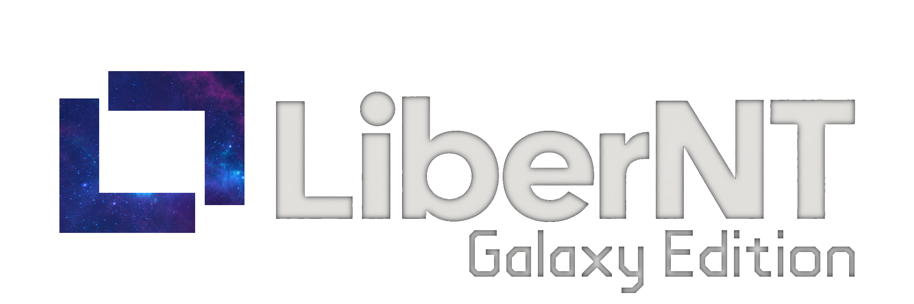

> [English](../../README.md) | [中文](../zh-CN/README.md) | [Français](../fr-FR/README.md) | [Español](../es-ES/README.md) | [日本語](../ja-JP/README.md) | [العربية](../ar-MA/README.md) | **Українська**

<p align="center">
  
</p>

> [!IMPORTANT]
> LiberNT: Galaxy Edition активно розробляється. Збірки на сторінці [Releases](https://github.com/LotusBrowser/LiberNT.Galaxy/releases) є попередніми Debug-версіями для тестування: запускайте їх у віртуальній машині або на запасному обладнанні, а не на робочому комп'ютері.

<div align="center">

# [LiberNT: Galaxy Edition](https://github.com/LotusBrowser/LiberNT.Galaxy)
### Вільна операційна система NT

**Створена з любові до архітектури NT. Сумісна з Windows® 11, для amd64, arm64 та riscv64.**

[](https://github.com/LotusBrowser/LiberNT.Galaxy/actions/workflows/build.yml)
[](#ліцензія)


<br>

[](https://github.com/LotusBrowser/LiberNT.Galaxy/releases)

</div>

---

<p align="center">
  
</p>

<p align="center"><sub>Робочий стіл LiberNT: Galaxy Edition на arm64, зі збірки nt10.0-043-2555 у QEMU</sub></p>

---

LiberNT: Galaxy Edition — це форк [LiberNT](https://github.com/LiberNT/LiberNT) із темою Galaxy. Ним володіє та підтримує його [Lotus](https://github.com/LotusBrowser); LiberNT залишається роботою його власних авторів.

LiberNT — це вільна операційна система NT. Її назва говорить сама за себе: *liber* латиною означає **вільний**. Вона орієнтована на **сумісність із Windows® 11**, залишаючи простір для експериментальних та авторських можливостей.

LiberNT: Galaxy Edition містить масштабну роботу над компонентами простору ядра та драйверами, спрямовану на стабільність і підтримку сучасного обладнання, фокусуючись на 64-бітних платформах: **amd64, arm64 та riscv64**.

Наша мета — система, яка залишається зручною для довготривалої підтримки: **стабільна, надійна та ефективна**, здатна працювати також на вбудованих пристроях і підтримувати всі можливості, які повинна мати сучасна операційна система.

> [!NOTE]
> Вперше чуєте про NT? **NT** — це архітектура, що лежить в основі кожної сучасної версії Windows: її ядро, модель драйверів та системні служби. LiberNT: Galaxy Edition — це вільна операційна система, створена на основі цієї архітектури, а Windows 11 є еталоном, з яким вона співставляється.

---

## Зміст

- [Що входить до LiberNT: Galaxy Edition](#що-входить-до-libernt-galaxy-edition)
- [Підтримувані платформи](#підтримувані-платформи)
- [Початок роботи](#початок-роботи)
  - [Крок 1: Завантажте збірку](#крок-1-завантажте-збірку)
  - [Крок 2: Завантажте систему](#крок-2-завантажте-систему)
  - [Крок 3: Встановіть LiberNT: Galaxy Edition](#крок-3-встановіть-libernt-galaxy-edition)
- [Збирання LiberNT: Galaxy Edition власноруч](#збирання-libernt-galaxy-edition-власноруч)
- [Хост-системи для збирання](#хост-системи-для-збирання)
- [Структура проєкту](#структура-проєкту)
- [Участь у розробці](#участь-у-розробці)
- [Використання ШІ](#використання-ші)
- [Ліцензія](#ліцензія)
- [Про проєкт](#про-проєкт)

---

## Що входить до LiberNT: Galaxy Edition

LiberNT: Galaxy Edition привносить підтримку сучасного обладнання та платформ до архітектури NT.

| Можливість | Що це означає для вас |
| --- | --- |
| **Орієнтація на 64-бітні системи** | Ядро, HAL та FreeLoader працюють на amd64, arm64 та riscv64. |
| **Завантаження через UEFI** | Завантажується на мікропрограмах UEFI з фреймбуфером GOP та ранньою підтримкою дисплея. |
| **Сучасні шини та накопичувачі** | PCIe, PCI, Plug and Play, USB з xHCI, SD/eMMC, а також драйвери накопичувачів і шин. |
| **Підтримка плат** | Реальні плати, включно з Raspberry Pi та його контролером введення-виведення RP1. |
| **Модель драйверів Windows 11** | Сумісність із Windows 11 (NT10) та реалізація моделі драйверів, перевірені щодо самої Windows 11. |
| **Графіка та x86-застосунки на Arm** | Графічна модель драйверів із Mesa, а також WoW64 з FEX доступні як опції збирання, які можна ввімкнути. |
| **LiberNT: Galaxy Edition Setup** | Відображає диски так само, як і програма встановлення Windows, створює, видаляє, форматує, зменшує та розширює розділи, а також встановлює LiberNT: Galaxy Edition на NTFS із необхідним системним розділом EFI. |
| **Власна збірка** | `menuconfig` дозволяє вибирати цільову архітектуру, компілятор, тип збірки та вмикати чи вимикати потрібні можливості. |

> [!TIP]
> Кожна збірка на сторінці [Releases](https://github.com/LotusBrowser/LiberNT.Galaxy/releases) містить список змін, внесених із часу попереднього випуску.

---

## Підтримувані платформи

| Архітектура | Попередньо зібрані образи | Збирання з вихідного коду | Примітки |
| --- | :---: | :---: | --- |
| **amd64** | ✓ | ✓ | Clang (за замовчуванням) або GCC |
| **arm64** | ✓ | ✓ | Включає підтримку Raspberry Pi |
| **riscv64** | ✓ | ✓ | Окремий образ збирається для плат JH7110 |
| **i386** | | ✓ | 32-бітна x86 |

Релізні збірки також включають образи для PowerPC.

---

## Початок роботи

### Крок 1: Завантажте збірку

Кожна збірка на сторінці [Releases](https://github.com/LotusBrowser/LiberNT.Galaxy/releases) постачається як один ZIP-файл для кожного образу та архітектури:

| Файл | Що це таке |
| --- | --- |
| `bootcd-iso-…-<arch>-…zip` | `bootcd.iso`, образ CD, що запускає LiberNT: Galaxy Edition або інсталятор LiberNT: Galaxy Edition Setup |

> [!NOTE]
> Це Debug-збірки, скомпільовані Clang автоматично через GitHub Actions із гілки `main-nt10`.

### Крок 2: Завантажте систему

Найшвидший спосіб спробувати LiberNT: Galaxy Edition — образ CD:

1. Розпакуйте завантажений файл, щоб отримати `bootcd.iso`
2. Запустіть його у віртуальній машині, наприклад **QEMU**, або завантажте з нього ПК

Він запускає LiberNT: Galaxy Edition або інсталятор LiberNT: Galaxy Edition Setup.

### Крок 3: Встановіть LiberNT: Galaxy Edition

Завантажте `bootcd.iso` у віртуальній машині або на комп'ютері та дотримуйтесь інструкцій **LiberNT: Galaxy Edition Setup**.

> [!CAUTION]
> Програма встановлення може видаляти та форматувати розділи. Створіть резервну копію всіх важливих даних на цільовому диску перед початком встановлення.

Повний посібник зі встановлення наведено в [INSTALL.md](INSTALL.md).

---

## Збирання LiberNT: Galaxy Edition власноруч

LiberNT: Galaxy Edition збирається за допомогою крос-інструментарію RosBE. Наведені нижче кроки працюють на Linux та macOS, а також у Windows через WSL2.

### 1. Встановіть інструментарій

Вам знадобляться Git, CMake, Ninja та компілятор C/C++ для вашої поточної системи. RosBE додає компілятори, які збирають LiberNT: Galaxy Edition.

```sh
curl -fsSL https://raw.githubusercontent.com/LiberNT/libernt-build-toolchain/main/rosbe-unix-bootstrap.sh | sh
```

> [!TIP]
> У Windows ми рекомендуємо використовувати WSL2. Встановіть його за допомогою команди `wsl --install`, відкрийте термінал Linux, який з'явиться, і виконуйте наведені інструкції для Linux. Зберігайте вихідний код у файловій системі Linux, а не в `/mnt/c`, де збирання виконується повільніше.

### 2. Отримайте вихідний код

```sh
git clone https://github.com/LotusBrowser/LiberNT.Galaxy.git
cd LiberNT.Galaxy
```

> [!NOTE]
> Перший запуск конфігурації також завантажує сабмодуль та зовнішні вихідні тексти, необхідні для збирання.

### 3. Налаштування (Configure)

```sh
./configure.sh
```

Без параметрів це налаштує збірку AMD64 Debug з Clang у папці `output-Clang-amd64-debug`. Назва папки завжди відповідає шаблону `output-<компілятор>-<архітектура>-<debug|release>`.

| Параметр | Що він робить |
| --- | --- |
| `-a`, `--arch <arch>` | Вибирає цільову архітектуру: `amd64` (за замовчуванням), `i386`, `arm64` або `riscv64`. |
| `--clang` | Збирає за допомогою Clang/LLVM із RosBE. Це значення за замовчуванням. |
| `--gcc` | Збирає за допомогою GCC із RosBE замість Clang. RosBE для macOS не включає GCC. |
| `-r`, `--release` | Створює оптимізовану збірку Release. Без цього параметра створюється збірка Debug, яку легше налагоджувати. |
| `menuconfig` | Відкриває меню для попереднього вибору додаткових компонентів. Ваш вибір зберігається у вихідній папці. |
| `makefiles` | Використовує `make` замість Ninja. |
| `--no-feeds-update` | Пропускає завантаження зовнішніх вихідних кодів, перелічених у `feeds.conf`, наприклад, під час роботи офлайн. |
| `-D<ім'я>=<значення>` | Передає налаштування безпосередньо до CMake. |

Наприклад:

```sh
./configure.sh -a arm64              # Збірка ARM64 Debug з Clang
./configure.sh -a i386 --gcc         # 32-бітна збірка x86 з GCC
./configure.sh -a amd64 --release    # оптимізована збірка AMD64
```

Для персоналізованого налаштування додайте `menuconfig`:

```sh
./configure.sh menuconfig
```

Ця команда відкриває меню (схоже на меню конфігурації ядра Linux), де ви можете вибрати цільову платформу, компілятор і тип збірки, а також увімкнути чи вимкнути різні компоненти: генерацію коду й оптимізацію, графічну модель драйверів та Mesa, WoW64 та FEX, налагодження ядра, тестові прогони тощо. Натисніть `?` на будь-якому пункті для довідки, `S` для збереження та `Q` для виходу. Ваш вибір зберігається у вихідній папці та використовується кожного разу під час повторної конфігурації.

### 4. Збирання

Перейдіть до вихідної папки та запустіть Ninja з потрібною ціллю:

```sh
cd output-Clang-amd64-debug
ninja bootcd
```

| Команда | Створює | Призначення |
| --- | --- | --- |
| `ninja bootcd` | `bootcd.iso` | Встановлення LiberNT: Galaxy Edition з образу CD у віртуальній машині або на комп'ютері. |

Ціль спочатку збирає все необхідне, і `bootcd.iso` записується у вихідну папку.

---

## Хост-системи для збирання

| Хост | Компілятори | Примітки |
| --- | --- | --- |
| **Linux** x86_64 / aarch64 | Clang та GCC | Повний інструментарій RosBE |
| **macOS** Intel / Apple Silicon | Clang | RosBE не має збірки GCC для macOS |
| **Windows** | Clang та GCC | Через WSL2, дотримуючись кроків для Linux |

На будь-якій системі встановіть Git, CMake, Ninja, Flex та Bison за допомогою вашого пакетного менеджера. RosBE надає лише крос-компілятори. Попередньо зібрані інструментарії знаходяться в [LiberNT/libernt-build-toolchain](https://github.com/LiberNT/libernt-build-toolchain).

---

## Структура проєкту

```text
LiberNT.Galaxy/
├── base/            # Програми, служби, встановлення та оболонка
├── boot/            # FreeLoader, завантажувальні дані та образи
├── bootloader/      # Менеджер завантаження, завантажувач Windows, підтримка UEFI та Open Firmware
├── dll/             # DLL простору користувача, включно з ntdll та бібліотеками Win32
├── drivers/         # Драйвери режиму ядра: шини, накопичувачі, файлові системи, мережа, введення тощо
├── hal/             # Рівні абстракції від обладнання для x86, Arm, Arm64, PowerPC та RISC-V
├── media/           # Шрифти, теми, файли INF, звуки та брендування
├── modules/         # Додаткові програми, тести та шпалери
├── ntoskrnl/        # Ядро NT та виконавча підсистема
├── sdk/             # Заголовні файли, бібліотеки та інструменти збирання
├── submodules/      # Рецепти та патчі для зовнішніх компонентів
├── subsystems/      # CSRSS та підсистема Windows
├── win32ss/         # win32k, USER, GDI та драйвери дисплея
├── configure.sh     # Скрипт конфігурації для Linux, macOS та WSL2
└── configure.cmd    # Скрипт конфігурації для Windows
```

---

## Участь у розробці

Повідомляйте про помилки та пропонуйте нові можливості в [Issues](https://github.com/LotusBrowser/LiberNT.Galaxy/issues); посібники та нотатки можна знайти у [Wiki](https://github.com/LotusBrowser/LiberNT.Galaxy/wiki).

Див. [CONTRIBUTING.md](CONTRIBUTING.md) та [PULL_REQUEST_MANAGEMENT.md](PULL_REQUEST_MANAGEMENT.md). Якщо ви плануєте значні зміни, спершу запитайте про це в [Issues](https://github.com/LotusBrowser/LiberNT.Galaxy/issues).

> [!WARNING]
> **Юридичне застереження:** Якщо ви бачили пропрієтарний вихідний код Microsoft Windows (включно з, але не обмежуючись витоками вихідного коду Windows NT 3.5, NT 4, 2000 та Windows Research Kernel), ваш внесок не буде прийнято через потенційне порушення авторських прав.

---

## Використання ШІ

Ми хочемо пояснити прямо: ШІ є частиною того, як розробляється LiberNT: Galaxy Edition. Він допомагає нам рецензувати та писати код, і все написане ним згодом перевіряється людиною. Перш ніж щось потрапить до гілки main, людина запускає та перевіряє наскрізні тести. Цей проєкт для нас надто важливий, щоб пропустити регресію.

Він також допомагає нам читати документацію, вилучати визначення та виправляти помилки. Для кожної помилки він порівнює написане в офіційній документації Microsoft Learn із тим, що насправді робить наша функція, щоб ми бачили, де саме різниться поведінка.

Як і будь-який інструмент, ШІ допомагає нам досягати поставлених цілей. Він дотримується тих самих правил, яких дотримуємося ми самі, описаних в [AGENTS.md](../../AGENTS.md):

- Ми розробляємо код на основі заголовків Windows SDK та WDK, публічних символів Windows 11, документації Microsoft та запусків за принципом «чорної скриньки» на Windows 11.
- Ми залишаємося в межах «чистої кімнати»: ми ніколи не копіюємо дизасембльований чи декомпільований код Windows і ніколи не копіюємо код під GPL з Linux.
- Виправлення вважається виправленням лише тоді, коли ми побачили його роботу під час реального завантаження або виконання тесту. Після успішного проходження тестів майбутній CI підтримуватиме їх проходження та зберігатиме наш прогрес.
- Ми порівнюємо результати наших тестів перевірка за перевіркою з тими самими тестами, запущеними на Windows 11.

> [!TIP]
> Якщо ви використовуєте ШІ у власних внесках, ми вам також раді. Просто вкажіть у пул-реквесті, з якими частинами він допоміг і як ви їх протестували. Ця чесність — усе, про що ми просимо.

---

## Ліцензія

LiberNT: Galaxy Edition поширюється за ліцензією [GNU GPL 3.0](../../COPYING). Код, успадкований від інших проєктів, зберігає ліцензію, зазначену в заголовках його файлів — переважно GPL 2.0 або новішу. Тексти GPL 2.0, LGPL 2.1 та BSD, на які посилаються ці файли, наведено в [COPYING2](../../COPYING2), [COPYING.LIB](../../COPYING.LIB) та [COPYING.ARM](../../COPYING.ARM).

Зміни, внесені до LiberNT: Galaxy Edition, захищені авторським правом © 2026 Lotus. Успадкований і сторонній код зберігає повідомлення про авторські права його авторів. Див. [CREDITS.md](../../CREDITS.md).

LiberNT: Galaxy Edition — це незалежний проєкт. Він не пов'язаний із корпорацією Microsoft, не схвалений і не фінансується нею. Windows® є зареєстрованою торговою маркою корпорації Microsoft.

---

## Про проєкт

LiberNT: Galaxy Edition належить [Lotus](https://github.com/LotusBrowser), яка його підтримує. Це форк LiberNT, що створюється **авторами LiberNT**; LiberNT започаткував [Ahmed Arif](https://github.com/ahmedarif193), а підтримують його [Ahmed Arif](https://github.com/ahmedarif193), [Ostap Brehin](https://github.com/osbre) та [Vivyy](https://github.com/enginelesscc).

- [Організація Lotus на GitHub](https://github.com/LotusBrowser)
- [Оригінальний проєкт: LiberNT](https://github.com/LiberNT/LiberNT)
- [Вебсайт LiberNT](https://libernt.com)
- [Завантажити останню збірку](https://github.com/LotusBrowser/LiberNT.Galaxy/releases)
- [Wiki](https://github.com/LotusBrowser/LiberNT.Galaxy/wiki)
